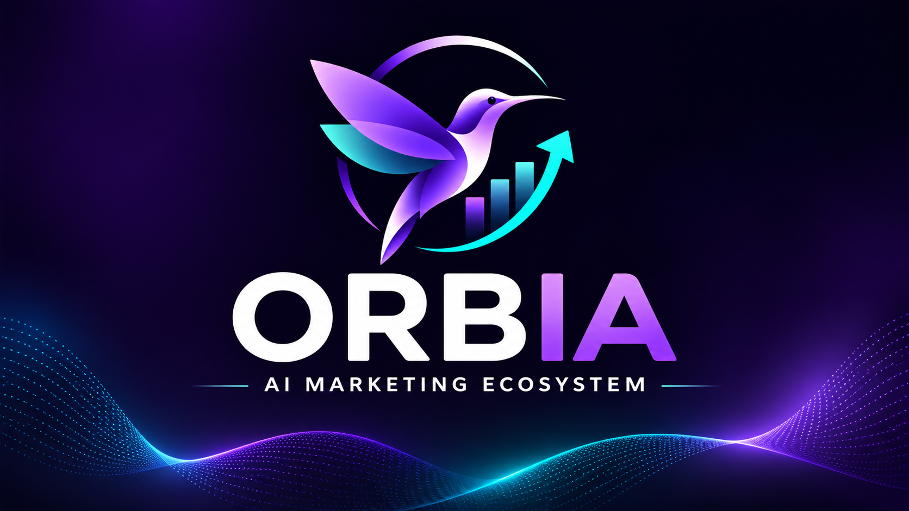

<div align="center">

  

  # 🚀 ORBIA · AI Marketing OS & Skill Orchestrator
  ### Sistema Integral de Gobernanza, Dirección Creativa Multicanal y Suite de Habilidades de IA
  **Challenge ONE AI (G11) — Ruta 2: Marketing de Contenidos con IA**  
  *Alura Latam & Oracle Next Education (ONE)*

  ---

  **Autora:** Julia Daniela Rodriguez  
  **Proyecto:** AI Marketing OS & Skill Orchestrator  
  **Versión:** 2.0 (Full Dynamic Multi-Brand & Multi-Provider AI)  
  **Demo Web:** `http://localhost:5173` | React 18 + Vite 5 + Vanilla CSS

  ---

  [](https://react.dev/)
  [](https://vitejs.dev/)
  [](https://aistudio.google.com/)
  [](https://openrouter.ai/)
  [](https://groq.com/)
  [](https://platform.openai.com/)
  [](https://antigravity.dev/)
  [](LICENSE)

</div>

---

## 📌 Tabla de Contenidos
1. [Descripción del Proyecto y Propósito](#-descripción-del-proyecto-y-propósito)
2. [Ecosistema de Casos de Estudio](#-ecosistema-de-casos-de-estudio)
   - [Caso Principal: Taranis Black (Mobiliario & NR-17)](#1-caso-principal-taranis-black)
   - [Caso Pedagógico: Penélope Skincare (Belleza en Cuidar)](#2-caso-pedagógico-penélope-skincare)
   - [Motor Multimarca Dinámico (Altiora Tech & Nuevas Empresas)](#3-motor-multimarca-dinámico)
3. [Recorrido de la Plataforma (4 Pasos de la Ruta 2)](#-recorrido-de-la-plataforma)
   - [Paso 1: Matriz Estratégica de Impacto & Resumen Ejecutivo](#paso-1-matriz-estratégica-de-impacto-y-resumen-ejecutivo)
   - [Paso 2: Gobernanza Verbal & Auditor de Tono en Vivo](#paso-2-gobernanza-verbal-y-auditor-de-tono)
   - [Paso 3: Suite de Skills, Playground y Diseñador Asistido por IA](#paso-3-suite-de-skills-y-diseñador-con-ia)
   - [Paso 4: Showroom Multicanal, Calendario Editorial y Calculadora de ROI](#paso-4-showroom-multicanal-calendario-y-roi)
4. [Asistente Interactivo de Campañas en 3 Pasos (Sin Datos Hardcodeados)](#-asistente-interactivo-en-3-pasos)
5. [Motor de IA Multi-Modelo y Sanitización Semántica](#-motor-de-ia-multi-modelo)
6. [Diseño y Experiencia de Usuario (Modo Oscuro & Claro)](#-diseño-y-experiencia-de-usuario)
7. [Estructura del Repositorio](#-estructura-del-repositorio)
8. [Instalación y Puesta en Marcha](#-instalación-y-puesta-en-marcha)
9. [Cumplimiento Normativo y Gobernanza (LGPD / HITL)](#-cumplimiento-normativo-y-gobernanza)

---

## 🎯 Descripción del Proyecto y Propósito

**ORBIA** es un sistema operativo de marketing y orquestador de habilidades (*Skills / Gems*) de Inteligencia Artificial desarrollado para resolver el dolor crítico identificado en la encuesta interna de clima (REG-009 y REG-010): **un equipo de marketing de solo 4 personas sobrecargado, operando 5 canales digitales simultáneos y viviendo en un ciclo permanente de «apagar incendios»**.

### El Reto que Transforma:
* **Antes:** 6 horas de producción por campaña, 5 días de espera por diseñadores freelancers externos, inconsistencia en el tono de voz entre distintos redactores y más de 24 horas para responder mensajes y comentarios en redes sociales.
* **Ahora:** Reducción del **70 % en tiempos de producción**, ahorro del **60 % en diseño in-house**, auditoría semántica en tiempo real con calificación de 1 a 10 y respuestas asistidas con supervisión humana en **menos de 15 minutos**, liberando **~102 horas mensuales** (>25 h/mes por colaborador).

---

## 🏢 Ecosistema de Casos de Estudio

ORBIA no es una interfaz estática; es un entorno multimarca dinámico con persistencia local en `localStorage`:

### 1. Caso Principal: Taranis Black
* **Sector:** Mobiliario Corporativo de Alta Performance & Ergonomía Activa (NR-17).
* **Posicionamiento:** Soluciones ergonómicas preventivas para comités decisores B2B (C-Level, Directores de RR. HH., Facilities, Arquitectos) y profesionales en trabajo híbrido.
* **4 Pilares de Tono:** Científico y fundamentado, Empático y humano, Sofisticado y premium, Sencillo y accesible.
* **Guardrails Obligatorios:** Prohibido usar lenguaje de urgencia agresiva (*«liquidación»*, *«barato»*, *«compra ahora»*) y promesas médicas no científicas (*«cura definitiva»*, *«milagroso»*).
* **9 Skills / Gems Preconfigurados:** Orquestador de Flujo, Guardián del Tono, Guionista Social, Multiplicador Multicanal, Especialista SEO/GEO, Director Creativo Visual (Gem 06), Triaje de Redes (<24h), Calculadora Consultiva de ROI y Asistente Multicanal.

### 2. Caso Pedagógico: Penélope Skincare
* **Sector:** Cosméticos D2C & Skincare Brasileño Accesible-Premium.
* **Posicionamiento:** *Belleza en Cuidar* — Autocuidado sin promesas milagrosas.
* **Pilares de Tono:** Claridad ante todo, Afecto sin exageración, Autoridad ligera y Posicionamiento con propósito.
* **Regla de Oro Editorial:** Proporción 3:1 (3 contenidos educativos de valor por cada post de venta).
* **Skills Propias:** 6 Gems del curso adaptados con paleta magenta (`#C2185B`) y pieles reales sin filtros.

### 3. Motor Multimarca Dinámico (Altiora Tech y Cualquier Empresa)
* **Creación de Workspaces Limpios:** Permite dar de alta cualquier empresa (ej. **Altiora Tech** — *Software con propósito*).
* **Cero Hardcoding:** Se adapta a **8 sectores comerciales**: Software/Tech, Servicios Profesionales, Salud/Clínicas, Gastronomía, Retail D2C, Educación, Agencia y Negocio General B2B.
* **Activos Visuales Adaptativos (`AdaptiveBrandVisualCard`):** Si la empresa no es de tecnología ni mobiliario, genera mockups editoriales elegantes con insignias temáticas (`🥐 Gastronomía`, `🩺 Salud`, `⚖️ Servicios`) y directivas de arte sin asignar fotos descontextualizadas.

---

## 🧭 Recorrido de la Plataforma

La aplicación se estructura en torno a los 4 pasos formativos del reto:

### Paso 1: Matriz Estratégica de Impacto y Resumen Ejecutivo
* **KPIs Operativos:** Cuadros de mando con horas liberadas, aceleración de producción y SLA de atención.
* **Resumen Ejecutivo Oficial:** Memo estructurado para la Dirección Ejecutiva (CEO) con diagnóstico de dolores, 3 iniciativas estratégicas y métricas de impacto económico.
* **Matriz de Priorización:** Clasificación de proyectos en cuadrantes (Quick Wins vs. Proyectos Estratégicos).

### Paso 2: Gobernanza Verbal y Auditor de Tono
* **Auditor Semántico en Tiempo Real:** Evalúa cualquier texto o borrador y entrega una calificación de 1 a 10.
* **Detección de Vocabulario Prohibido:** Alerta instantánea si se detectan palabras no permitidas.
* **Reescritura Oficial:** Versión reescrita bajo la personalidad exacta de la marca activa.
* **Modo Interactivo:** Posibilidad de cargar casos reales o escribir borradores libres.

### Paso 3: Suite de Skills y Diseñador con IA
* **Playground de Ejecución:** Prueba cada Skill con casos de prueba precargados o prompts personalizados en vivo.
* **Diseñador Asistido por IA (`designSkillWithAI`):** Escribe una necesidad en lenguaje cotidiano (ej: *"quiero responder preguntas frecuentes"*) y la IA estructura automáticamente los 4 bloques del prompt:
  1. *Quién eres (Role-Based Prompting).*
  2. *Base de conocimiento inyectada ({{catalogo_reglas}}, {{pilares_tono}}).*
  3. *Formato estructurado de salida (Structured Output).*
  4. *Guardrails y restricciones ({{vocabulario_prohibido}}).*
* **Exportación Estándar:** Copiado y descarga directa en archivo `.md` bajo el formato estándar de **Antigravity Skills (`SKILL.md`)**.

### Paso 4: Showroom Multicanal, Calendario y ROI
* **Previsualizadores Nativos de Canales:**
  - **LinkedIn B2B:** Post de autoridad con métricas de interacción, autor y formato 16:9.
  - **Instagram Carrusel:** Visor interactivo de 5 a 6 slides en formato 4:5 con notas de dirección de arte.
  - **E-mail Marketing:** Asunto, pre-header, cuerpo de correo y botón CTA.
  - **TikTok / Reels:** Guion estructurado segundo a segundo con gancho visual en los primeros 3 segundos.
* **Calendario Editorial Mensual (12 Piezas / 4 Semanas):**
  - Matriz balanceada bajo la regla 3:1 (40 % Educar, 30 % Inspirar, 30 % Involucrar).
  - Filtros dinámicos por canal y por pilar de contenido.
  - Modal emergente para inspeccionar el copy completo, hook y público objetivo de cada pieza.
* **Calculadora Interactiva de Retorno de Inversión (ROI):**
  - Sliders interactivos para modelar colaboradores, salarios, bajas médicas y pérdidas por ruido.
  - Diagnóstico de costo oculto de ausentismo y horas de foco recuperadas.
  - **Exportación a PDF:** Generador de reportes ejecutivos listos para imprimir o adjuntar a cotizaciones.

---

## 🛠️ Asistente Interactivo en 3 Pasos

Para garantizar que cualquier empresa nueva cuente con un showroom auténtico y útil, se implementó el **Wizard Estratégico**:

```
┌─────────────────────────────────────────────────────────────────────────────┐
│ 📝 WIZARD ESTRATÉGICO DE CAMPAÑA MULTICANAL                                 │
├─────────────────────────────────────────────────────────────────────────────┤
│ 1. Oferta & Sector:                                                         │
│    • Selección de industria (Tech, Servicios, Salud, Alimentos, Retail...) │
│    • Productos o servicios estrella reales                                  │
│    • Gran diferencial competitivo frente al mercado                         │
├─────────────────────────────────────────────────────────────────────────────┤
│ 2. Cliente & Objeciones:                                                    │
│    • Buyer Persona / Decisor ideal                                          │
│    • Mayor dolor o frustración (usado de hook en video y portada)           │
│    • Principal objeción comercial (usada para el rebate en carrusel/email) │
├─────────────────────────────────────────────────────────────────────────────┤
│ 3. Estética & Calculadora:                                                  │
│    • Moodboards visuales (Minimalista Moderno, Cálido, Clínico, Lujo, etc.) │
│    • Métrica de calculadora (Horas ahorradas, Costos, LTV / Retención)      │
│    • URL opcional de fotografía de producto                                 │
└─────────────────────────────────────────────────────────────────────────────┘
```

Al finalizar, la IA genera en paralelo las 4 piezas multicanal, el calendario mensual de 12 entregas y los parámetros de la calculadora, guardando todo en el perfil de la empresa.

---

## 🧠 Motor de IA Multi-Modelo

ORBIA permite alternar entre proveedores de IA en caliente desde la barra superior:

| Proveedor | Modelos Compatibles | Estado / Clave |
| :--- | :--- | :--- |
| **⚡ Simulador Local** | Respuestas Prevalidadas del Curso (v3.0) | Sin API Key · 100 % Gratuito |
| **✨ Google Gemini** | `gemini-3.8-flash`, `gemini-3.6-flash`, `gemini-2.5-flash` | API Key de Google AI Studio |
| **🌐 OpenRouter** | `nvidia/nemotron-3.5-lightning:free`, `openrouter/free` | API Key gratuita de OpenRouter |
| **🚀 Groq Cloud** | `llama-3.3-70b-versatile`, `deepseek-r1-distill-llama-70b` | API Key de Groq Console (500+ tok/s) |
| **🧠 OpenAI** | `gpt-4o`, `gpt-4o-mini`, `o3-mini` | API Key de OpenAI Platform |

### Sanitización Semántica Inteligente (`sanitizeSkillTitle`)
El motor cuenta con un algoritmo de procesamiento de lenguaje natural que analiza la intención del usuario y elimina muletillas conversacionales (*«quiero una skill para...»*), transformándolas en títulos ejecutivos de alto estándar (ej: *«Asistente de Preguntas Frecuentes & Soporte»* o *«Consultor de Manejo de Objeciones Comerciales»*).

---

## 🎨 Diseño y Experiencia de Usuario

* **Doble Modo Visual (Dark / Light):**
  - **Modo Oscuro Profundo:** Fondo `#0b0c10`, tarjetas `#171a24` con sutiles bordes luminosos y tipografía `-webkit-font-smoothing` de alta legibilidad.
  - **Modo Claro de Alto Contraste:** Fondo `#f8fafc`, tarjetas `#ffffff` con textos en `#0f172a` y `#334155` optimizados para lectura diurna prolongada.
* **Identidad de Marca:** Logotipo oficial de ORBIA en formato PNG con soporte de transparencia y Favicon integrado.
* **Componentes 100 % Responsive:** Adaptables a monitores de escritorio, notebooks y tablets.

---

## 📂 Estructura del Repositorio

```text
.
├── .agents/                                # Habilidades oficiales de Antigravity (SKILL.md)
│   └── skills/
│       ├── taranis-00-orquestador-validador/
│       ├── taranis-01-brainstorming/
│       ├── taranis-02-guardian-tono/
│       ├── taranis-03-guionista-social/
│       ├── taranis-04-multiplicador-multicanal/
│       ├── taranis-05-especialista-seo-geo/
│       ├── taranis-06-director-creativo-visual/
│       ├── taranis-07-triaje-redes-objeciones/
│       ├── taranis-08-diagnostico-roi-nr17/
│       └── estratega-multicanal-taranis-black/
├── docs/                                   # Archivos oficiales y entregables del reto
│   ├── Gems_Taranis_Black/                 # Prompts maestros (Gem Maestro, Gem 06 v2.0)
│   ├── Kit_de_datos_Taranis_Black_ES/      # Base de conocimiento (Catálogo, Artículo base en PDF)
│   ├── Entregables_Taranis_Black/          # Documento oficial de entrega (.docx)
│   └── Guia_uso_plantillas_entrega_oficial_ES.pdf
├── public/
│   ├── assets/                             # Identidad visual (Logo-ORBIA.png, fotos HD de campaña y tech)
│   └── favicon.png                         # Favicon oficial
├── src/
│   ├── components/
│   │   ├── MarkdownRenderer.jsx            # Renderizador seguro de Markdown con badges
│   │   └── ShowroomStep4.jsx               # Showroom Multicanal, Wizard 3 Pasos y Calculadora ROI
│   ├── data/
│   │   ├── initialBrands.js                # Marcas base (Taranis Black y Penélope Skincare)
│   │   ├── initialSkills.js                # Definición, plantillas y compilador de Skills
│   │   └── showroomData.js                 # Datos y piezas multicanal pre-validadas
│   ├── utils/
│   │   ├── aiEngine.js                     # Motor de IA multi-proveedor, sanitización y generador
│   │   └── exportPdf.js                    # Generador de reportes ejecutivos en PDF
│   ├── App.jsx                             # Componente principal, navegación, topbar y modales
│   ├── index.css                           # Sistema de diseño con variables para Dark / Light mode
│   └── main.jsx                            # Punto de entrada de React 18
├── .gitignore                              # Exclusión de node_modules y dist
├── index.html                              # Shell HTML con metatags y favicon
├── package.json                            # Dependencias y scripts
├── vite.config.js                          # Configuración de compilador Vite
└── README.md                               # Documentación oficial del proyecto
```

---

## ⚡ Instalación y Puesta en Marcha

Sigue estos sencillos pasos para ejecutar el proyecto en tu entorno local:

### 1. Clonar el Repositorio
```bash
git clone https://github.com/JuliaDaniR/orbia-ai-marketing.git
cd orbia-ai-marketing
```

### 2. Instalar Dependencias
```bash
npm install
```

### 3. Iniciar el Servidor de Desarrollo
```bash
npm run dev
```
La aplicación se abrirá automáticamente en `http://localhost:5173`.

### 4. Compilar para Producción
```bash
npm run build
```
Generará los archivos optimizados en la carpeta `dist/`.

---

## 🔒 Cumplimiento Normativo y Gobernanza

El diseño de ORBIA incorpora las mejores prácticas internacionales de ética y gobernanza en IA:
1. **Human-in-the-Loop (HITL) Obligatorio:** Ninguna pieza se publica o programa directamente sin validación humana previa por parte del equipo editorial o de marketing.
2. **Cero Alucinaciones en Catálogo:** Los agentes tienen guardrails estrictos que prohíben inventar precios, dimensiones, plazos de entrega o laudos técnicos fuera de la base de conocimiento inyectada.
3. **Privacidad y Protección de Datos:** Cumplimiento con la **LGPD (Ley 13.709/2018 de Brasil)** y la **Ley 25.326 de Protección de Datos Personales de Argentina**. Los prompts de triaje anonimizan datos personales y escalan cotizaciones corporativas a asesores comerciales humanos.

---

<div align="center">
  <sub>Desarrollado con dedicación y excelencia por <strong>Julia Daniela Rodriguez</strong> para el <strong>Challenge ONE AI (G11)</strong> de <strong>Alura Latam & Oracle ONE</strong>.</sub>
</div>
